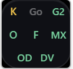
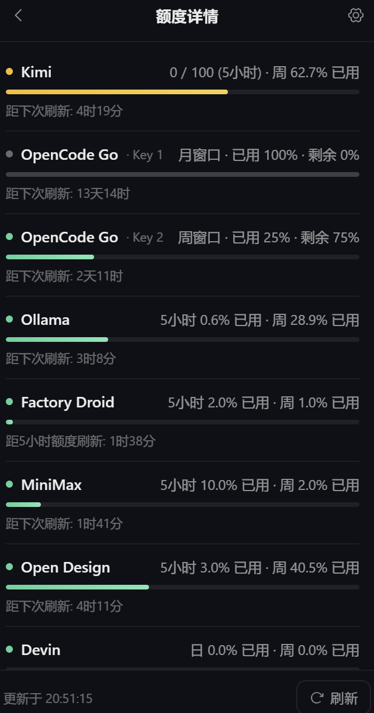

# Quota Viewer

**[English](README.md)** | [简体中文](README.zh-CN.md)

A desktop floating ball + AI platform quota monitoring tool: displays API quota / balance remaining for various AI platforms in real time.




**11 platforms**: [Kimi](https://platform.kimi.com) · [Xfyun](https://maas.xfyun.cn) · [OpenCode Go](https://opencode.ai/zen) · [Xiaomi MiMo](https://platform.xiaomimimo.com) · [DeepSeek](https://www.deepseek.com/platform) · [Ollama](https://ollama.com/settings) · [Command Code](https://commandcode.ai) · [Factory Droid](https://factory.ai) · [MiniMax](https://platform.minimaxi.com) · [Open Design](https://open-design.ai) · [Devin](https://app.devin.ai)

> The registry supports 11 platforms. A **monitored object** is one credential × one plan card, so a platform with two API keys or two plans takes more than one cell. The floating ball shows **up to 9 objects normally, up to 16 in extended mode**; anything beyond that collapses into a `+N` cell (the panel still lists every object).

- **Tech Stack**: Go 1.24 + Wails v2.12.0 + Vanilla HTML/CSS/JS (Vite bundling)
- **Platform**: Windows 10+ (WebView2 Runtime)
- **Footprint**: ~10.9 MB single executable, ~60 MB working set while running

## Features

- **Floating Ball**: 60×60 glassmorphic square showing enabled providers (cell color = status: green / yellow / red), hover tooltip for per-platform details
- **Adaptive Cells**: one cell per monitored object. One to three cells sit in a single row (1 fills the whole ball, 2 split it in half, 3 in thirds); 4 cells use a 2×2 grid, 5-9 wrap in 3 columns, 10-16 in 4 columns. Over the cap, the last cell becomes `+N` instead of silently dropping objects
- **Expandable Panel**: Progress bars + remaining quota details (thousands-separated numbers), auto-refresh (default 15 min), refresh countdown timer (e.g. Kimi 5-hour window reset)
- **Budget Progress Bar**: Balance-type providers (e.g. DeepSeek) support a configurable budget — progress bar shows consumption as `(budget - balance) / budget`, default budget ¥300
- **Config Panel**: Check which providers to display (**up to 9 monitored objects normally, up to 16 with extended mode on; at least 1**), each provider has its own credential inputs (API Key / Cookie) and can hold **several credential groups** ("+ add another credential" for a second key / second account), each group gets its own cell. Supports pasting browser "Copy as PowerShell" format directly
- **System Tray**: Refresh / Show-Hide / Open Config / Quit; click the tray icon to bring the floating ball to the front (show/hide lives in the tray menu; double-click no longer toggles it)
- **Window Positioning**: Expand without going off-screen (smart corner flipping, multi-monitor / DPI scaling adaptive), collapse precisely back to original position
- Close to tray, does not exit the process

## Supported Providers

| Provider | Credential | Type | Displays |
|----------|------------|------|----------|
| [Kimi](https://platform.kimi.com) | API Key (`sk-kimi-xxx`) | usage | 5-hour window / weekly quota usage |
| [Xfyun](https://maas.xfyun.cn) (讯飞星辰) | Cookie | usage | Package total usage |
| [OpenCode Go](https://opencode.ai/zen) | API Key (`oc_sk-...`, or auto-read `~/.local/share/opencode/auth.json` if empty) | usage | Rolling window quota percentage |
| [Xiaomi MiMo](https://platform.xiaomimimo.com) | Cookie | usage | Package token usage |
| [DeepSeek](https://www.deepseek.com/platform) | API Key (`sk-...`) | balance | Account balance (balance type) |
| [Ollama](https://ollama.com/settings) | Browser session Cookie | usage | Cloud 5-hour Session usage / weekly usage (settings page) |
| [Command Code](https://commandcode.ai) | API Key (`user_...`, or auto-read `~/.commandcode/auth.json` if empty) | usage | 5-hour / weekly rolling window usage + remaining credits |
| [Factory Droid](https://factory.ai) | API Key (`fk-...`, or auto-read `~/.factory/.env` if empty) | usage | 5-hour / weekly / monthly windows + Core pool usage |
| [MiniMax](https://platform.minimaxi.com) | Subscription Key (`sk-cp-...`) | usage | 5-hour / weekly window usage (Token Plan) |
| [Open Design](https://open-design.ai) | Browser session Cookie | usage | Design Plan 5-hour / 7-day quota usage |
| [Devin](https://app.devin.ai) | Token (or auto-read the local Devin Desktop login if empty) | usage | Daily / weekly quota usage of the Devin plan |

> Tip: For Cookie-based providers, you can paste the entire "Copy as PowerShell" script from your browser's F12 → Network tab, and it will be automatically parsed into a Cookie header on save.

## Command-Line Probe

Besides the GUI there is a headless probe, handy for scripts, status bars and external tooling:

```bash
go build -o build/bin/quota-viewer-cli.exe ./cmd/quotaviewer
```

- `quota-viewer-cli.exe --json` — prints **one line of JSON** with every monitored object's quota to stdout and exits `0`
- no argument, or an unknown argument — prints usage to stderr, writes nothing to stdout, exits `2`

**Record shape (`schema: 2`)** — one record per monitored object, so a platform with two keys or two plans yields two records:

```json
{"schema":2,"generated_at":"...","extended_mode":true,"enabled_limit":16,"enabled_count":2,
 "providers":[
   {"id":"kimi","slot":"kimi/0","sub_label":"","kind":"usage","percent":26,"remaining_percent":74,"reset_at":null,"balance":null,"currency":null,"error":""},
   {"id":"minimax","slot":"minimax/1/p1","sub_label":"Key 2 · 视频赠送卡","kind":"usage","percent":80,"remaining_percent":20,"reset_at":null,"balance":null,"currency":null,"error":""}
 ],"error":""}
```

`slot` identifies the object (`<provider>/<credential group>[/p<plan card>]`); `sub_label` is empty for single-object platforms. `enabled_limit` is the ball's object cap (9 / 16) and records are truncated to it. `schema` was `1` before multi-key/multi-plan support: the only breaking part is the two added keys — consumers reading by key name are unaffected.

## Monitoring Open Design

[Open Design](https://open-design.ai) is a design-agent workspace; its quota comes from a **Design Plan** subscription, exposed as a **5-hour window and a 7-day window**.

Quota Viewer reads those windows from Open Design's control plane, and this is the one provider that **cannot** use an API key: keys of the form `sk-amr-` get a `401` from the control plane, so a **browser session Cookie is required**.

To get it: sign in at `open-design.ai/cloud/dashboard`, open F12 → Network, copy the request as a Cookie (or use "Copy as PowerShell" and paste the whole script), then paste it into the Open Design card in the config panel. When the session expires, sign in again and replace the Cookie.

## How to monitor Devin

[Devin](https://app.devin.ai) is an AI software engineer; its quota comes with the Devin subscription and is tracked as a **daily window and a weekly window**.

Devin has no public quota API — self-serve plans get a `403` from the enterprise consumption endpoints, with no switch to enable it — so Quota Viewer reads those two windows from the same private seat-management endpoint Devin Desktop itself calls. **If you are signed in to Devin Desktop on this machine, leave the token field empty** and the login is picked up automatically (the local `state.vscdb` is byte-scanned, no SQLite driver involved). Paste a token by hand only if that automatic path stops working: the token is the `devin-session-token$...` string stored in `%APPDATA%\Devin\User\globalStorage\state.vscdb`.

The ball shows a single `DV` cell: the percentage comes from the **busier of the two windows**, and the countdown is labelled with the window it belongs to (daily / weekly). When the token expires, sign in to Devin Desktop again or paste a fresh one. The plan name is never displayed.

## Development

```bash
# Install dependencies
go mod tidy
cd frontend && npm install && cd ..

# Development mode (hot reload)
wails dev

# Build
wails build
```

Output: `build/bin/quota-viewer.exe`

## Project Structure

```
├── app.go               # Wails app logic (window positioning, config, refresh orchestration)
├── main.go              # Entry point + Wails runtime options (frameless / AlwaysOnTop)
├── workarea_windows.go  # Win32 helpers (workarea query, DPI, min window width subclass)
├── workarea_other.go    # Non-Windows stub
├── cmd/
│   └── quotaviewer/     # Headless CLI probe entry point (--json)
├── internal/
│   ├── config/          # Config persistence (dynamic provider list + PowerShell cookie parsing)
│   ├── fetcher/         # Provider registry + per-platform fetchers
│   ├── probe/           # CLI probe implementation (shared fetcher orchestration)
│   └── tray/            # System tray (energye/systray)
└── frontend/
    ├── src/
    │   ├── index.html   # Floating ball + detail panel + config panel + Toast
    │   ├── main.js      # View state machine / dynamic ball cells / data rendering / interactions
    │   └── style.css    # Design tokens + dark glassmorphic theme
    └── dist/            # Vite build output (embedded into exe via go:embed)
```

## Adding a New Provider

Quota Viewer uses a registry-driven architecture — adding a new provider requires only a fetcher implementation + a registry entry, with **zero frontend changes**.

If you want your AI agent to add a new provider, copy and paste this to it:

> Read `docs/ADDING_A_PROVIDER.md` and follow it to add a new provider for the platform `<name>`. The endpoint is `<URL>`, authentication is `<method>`, and it should display `<what to show>`.

For manual steps, see [`docs/ADDING_A_PROVIDER.md`](docs/ADDING_A_PROVIDER.md).

## Disclaimer

This is an **unofficial** tool, not affiliated with any platform. Platform web structures and APIs may change at any time, causing fetchers to fail. Credentials are stored only in the local config file (`%APPDATA%\quota-viewer\config.json`) and are never uploaded to any server. Use at your own risk.

## License

[MIT](LICENSE)
